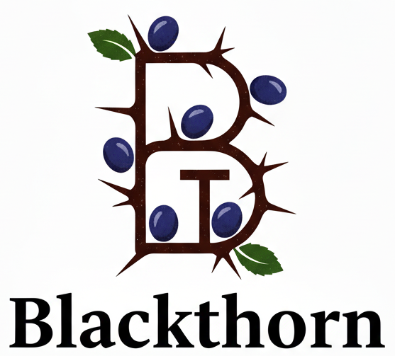

# 🌳 BlackThorn



**A behavior tree library for C++ that stays simple: one readable YAML file per tree, a real blackboard, and a free editor that shows your tree running live.**

> ⚠️ The API is still evolving. Expect breaking changes while the library matures.

> **🌐 Try the online version instantly:**
> 👉 [Click here to launch Oakular in your browser!](https://lecrapouille.github.io/BlackThorn/Oakular.html)

---

## 🤔 What is it for?

A robot, a drone or a game character must decide, many times per second, *what to do now*. Is the battery low? Go to the charger. Is there a box in front of me? Pick it. Did the box fall? Try again.

The first idea is a **state machine**: boxes and arrows. It works for five states. With fifty, every new behavior adds arrows everywhere, and nobody can read the drawing anymore.

A **behavior tree** solves this. You build a big behavior from small bricks, like Lego, and each brick does not know the others:

```text
                 Selector            "try the first branch that works"
                /        \
        Sequence          GoCharge   "do these steps in order"
       /        \
 BatteryOk      Clean
```

*Try to work: if the battery is OK, clean. If that fails, go to the charger.* You can move a brick, reuse it, replace it: the rest of the tree does not change. This is why behavior trees took over in video games (Halo, Unreal Engine) and then in robotics (ROS 2 Nav2).

**BlackThorn** gives you this in C++, with **Oakular**, an editor to draw the trees and watch them run. Never used a behavior tree? [The introduction](doc/01-Introduction.md) explains them in ten minutes, with no code.

---

## 📖 Why another behavior tree library?

The reference library in C++ is [BehaviorTree.CPP](https://www.behaviortree.dev/). I tried to use it, and I could never get along with it:

- 📄 **The trees are XML files**, and the XML does not hold what its editor, Groot, needs: you end up keeping several descriptions of the same nodes in sync.
- 💸 **The editor is not really free**: the full Groot2 is a paid product, and I never found it intuitive.
- 🏋️ **The C++ is heavy**: ports, configuration objects, templates everywhere, before your first action runs.

So I wanted my own library, with these points fixed. I started from [BrainTree](https://github.com/arvidsson/BrainTree): a small, clean header-only library, easy to read, but missing what a real project needs: no blackboard worth the name, no tree files, no subtrees, no editor. I added them one by one.

Then I asked LLMs to help me make the code **fast and cache friendly**. The result has nothing left of BrainTree: there is no more class hierarchy to walk at each tick. The state of all nodes lives in plain arrays, and one tick is a loop over them. What stayed is the goal: a library you can read in an afternoon.

*BlackThorn* plays with "BT" (behavior tree); the blackthorn is a thorny tree (*prunellier* or *épine noire* in French). *Oakular* mixes "oak" and "ocular": the eye that looks at the tree.

---

## ✨ Why BlackThorn?

| | 🌳 BlackThorn | BehaviorTree.CPP | BrainTree |
|---|---|---|---|
| Tree file | **one YAML file**: tree, starting values and subtrees | XML, plus what Groot needs | none: trees are written in C++ |
| Editor | **Oakular**: open source, free, can run inside your own application | Groot2 (full version paid) | none |
| Watch a running tree | ✅ live, nodes turn green, yellow, red | ✅ with Groot2 | ❌ |
| Blackboard | ✅ nested maps and lists, `${key}` references, one scope per subtree | ✅ | basic |
| Subtrees with inputs and outputs | ✅ | ✅ | ❌ |
| Simulated time (`Timeout`, `Wait`…) | ✅ the clock you give: a test runs the same, fast or slow | wall clock | — |
| Runtime | data-oriented: node states packed in arrays | one object per node, virtual calls | one object per node, virtual calls |
| Size of the code you must understand | small | large | very small |

What this means for you:

- 📝 **You read your trees.** YAML is short, has comments, and diffs well in git. The same file is opened by Oakular, run by your program, and reviewed by your team.
- 🎨 **You draw your trees** in Oakular, and you **watch them run**: start Oakular, run your program, and see which node is working, which one failed, and why your robot stopped.
- 🧩 **You keep your application.** The engine has no graphical dependency. The editor is a plain Dear ImGui widget that never opens a window: put it in your own tool. [RobotIK](https://github.com/Lecrapouille/RobotIK) does this in its robot simulator.
- 🧪 **You can test your trees.** Timed nodes read the clock you give them, so a simulation or a unit test controls time.
- ⚡ **It is fast.** `make benchmark` runs the same trees with BlackThorn and BehaviorTree.CPP and writes a report.

---

## 👀 What it looks like

A tree is a YAML file. It only gives **names** to the actions:

```yaml
BehaviorTree:
  Selector:
    children:
      - ReactiveSequence:              # asks BatteryOk again at every tick
          children:
            - Condition: { name: BatteryOk }
            - Action: { name: Clean }
      - Action: { name: GoCharge }
```

Your C++ says what each name does, builds the tree, and ticks it in your main loop:

```cpp
#include "BlackThorn/BlackThorn.hpp"

bt::NodeFactory factory;
factory.registerCondition("BatteryOk", [&]() { return robot.battery() > 20; });
factory.registerAction("Clean", [&]() { return robot.cleanStep(); });     // RUNNING until done
factory.registerAction("GoCharge", [&]() { return robot.goCharge(); });

auto result = bt::Builder::fromFile(factory, "tree.yaml");
if (!result) { std::cerr << result.getError() << std::endl; return 1; }
bt::Tree::Ptr tree = result.moveValue();

while (running)
{
    tree->tick();      // one decision, then back to your loop
}
```

That is all. Your first complete tree, compiled and run step by step: [doc/02-Getting-Started.md](doc/02-Getting-Started.md).

---

## 🚀 Quick start

```bash
# Ubuntu: sudo apt-get install libsfml-dev libglfw3-dev libglew-dev
# Fedora: sudo dnf install SFML-devel glfw-devel glew-devel
git clone https://github.com/Lecrapouille/BlackThorn --recurse-submodules
cd BlackThorn
make                               # library, Oakular, examples

./build/linux-gcc-release/bin/Oakular                    # the editor; Mode → Visualizer to watch a tree
./build/linux-gcc-release/bin/Example-Patrol             # a tree with subtrees, shown live in Oakular
```

A web version, built with Emscripten by the CI: [Oakular.html](https://lecrapouille.github.io/BlackThorn/Oakular.html). File > Open starts in the example trees. A save is downloaded by the browser. The live visualizer needs a program on your machine, so it stays on the desktop. The same sources also build for [ExaequOS](https://www.exaequos.com).

Use BlackThorn in your own project with [BlackThorn.mk](BlackThorn.mk) and [MyMakefile](https://github.com/Lecrapouille/MyMakefile): [doc/07-Oakular.md](doc/07-Oakular.md#-5-embed-oakular-in-your-application).

---

## 📚 Documentation

Start with chapters 1 and 2; the others are there when you need them.

| # | Chapter | Contents |
|---|---------|----------|
| | [doc/README.md](doc/README.md) | 🧭 Reading order and quick paths |
| 1 | [Introduction](doc/01-Introduction.md) | 🌱 Behavior trees in ten minutes: tick, status, nodes, blackboard |
| 2 | [Getting started](doc/02-Getting-Started.md) | 🚀 Build, run the examples, write your first tree |
| 3 | [The YAML format](doc/03-YAML-Format.md) | 📝 Tree, blackboard and subtrees in one file |
| 4 | [The nodes](doc/04-Nodes.md) | 🎯 Every built-in node and when to use it |
| 5 | [Your own nodes](doc/05-Your-Own-Nodes.md) | 🔨 Actions, conditions, ports, stopping work, simulated clock |
| 6 | [The blackboard](doc/06-Blackboard.md) | 🧠 Types, nested values, scopes of subtrees |
| 7 | [Oakular](doc/07-Oakular.md) | 🔭 Editor, live visualizer, protocol, embedding |
| 8 | [API reference](doc/08-API-Reference.md) | 📖 The classes, by task |
| 9 | [Examples](doc/09-Examples.md) | 🌟 What each example shows |
| | [src/Oakular/README.md](src/Oakular/README.md) | 💻 The `oakular::Editor` API |

Coding agents: [AGENTS.md](AGENTS.md) and the skills of `.claude/skills/`.

---

## 🔗 Read more about behavior trees

- [Introduction to behavior trees](https://roboticseabass.com/2021/05/08/introduction-to-behavior-trees/) – roboticseabass.com
- [Behavior trees in detail](https://lisyarus.github.io/blog/posts/behavior-trees.html) – lisyarus.github.io
- [BehaviorTree.CPP documentation](https://www.behaviortree.dev/) – the same ideas, in the other library

---

## 📝 License

Dual license: GNU GPL v3 or later, or a commercial license. See [LICENSING.md](LICENSING.md).
