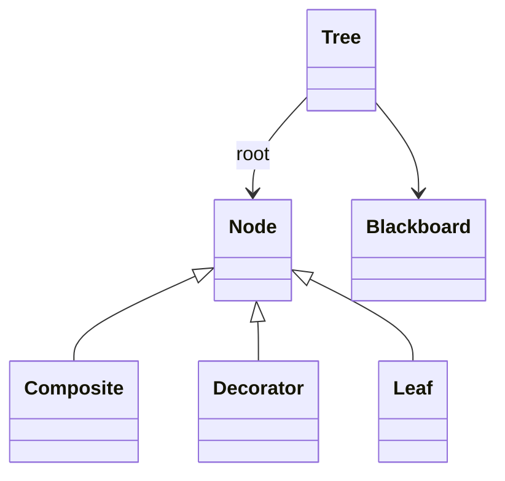
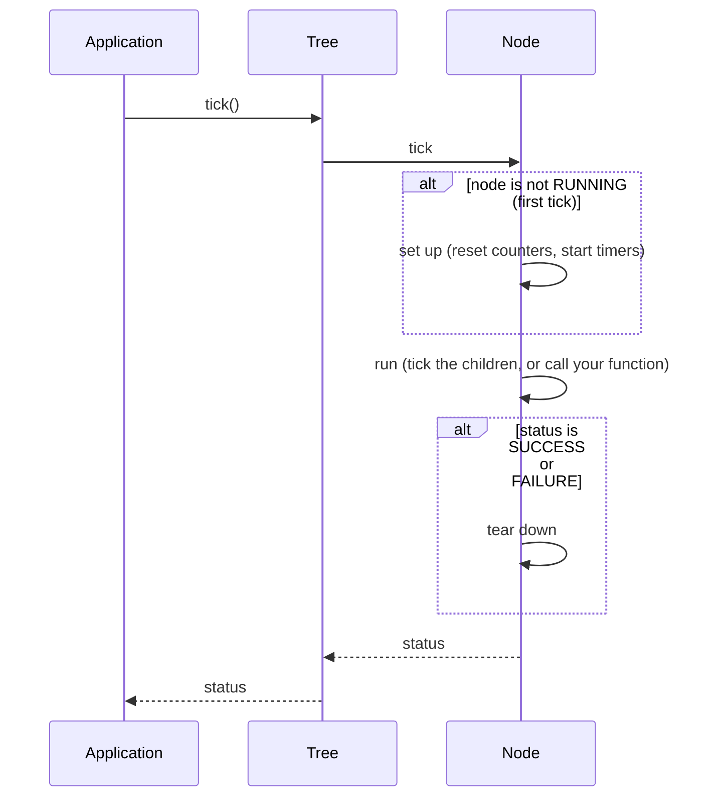

# 🌱 1. Introduction: behavior trees in ten minutes

This page is for people who never wrote a behavior tree. It explains the words you will meet in the rest of the documentation, then what BlackThorn does with them. No C++ here: only ideas and pictures.

If you already know behavior trees, read only [§5 Why BlackThorn?](#-5-why-blackthorn) and go to [02-Getting-Started.md](02-Getting-Started.md).

---

## 🤔 1. The problem: deciding what to do next

A robot, a game character or a drone must choose, many times per second, what to do next: *"Is the battery low? Then go to the charger. Else, is there a box in front of me? Then pick it…"*

The first idea is a **state machine**: boxes (states) and arrows (transitions). It works for five states. With fifty states, every new behavior adds arrows everywhere, and nobody can read the drawing.

A **behavior tree** (BT) solves this: you build a big behavior from small ones, like Lego bricks. Each brick does not know the others. You can move a brick, reuse it, or replace it, and the rest of the tree stays the same.

```text
               Selector                  "try the first branch that works"
              /        \
       Sequence         GoCharge          "do these steps in order"
      /        \
BatteryOk      Clean
```

Read it from the top, left to right: *"Try to work: if the battery is OK, clean. If this fails, go to the charger."*

---

## 📖 2. The words you will meet

| Word | Meaning |
|------|---------|
| **Node** | One brick of the tree. Every node returns a **status** when it runs. |
| **Root** | The node at the top. The application only talks to the root. |
| **Tick** | One run of the tree. The application calls `tick()` again and again (10 times per second for a robot, 60 for a game). |
| **Status** | What a node answers to a tick: `SUCCESS`, `FAILURE` or `RUNNING`. |
| **Leaf** | A node with no child. It does the real work (move a motor, read a sensor) or answers a question. |
| **Action** | A leaf that does something. It may take many ticks: then it returns `RUNNING`. |
| **Condition** | A leaf that answers a yes/no question, at once: `SUCCESS` (yes) or `FAILURE` (no). |
| **Composite** | A node with several children, such as `Sequence` and `Selector`. It decides which child to tick. |
| **Decorator** | A node with exactly one child. It changes the status of its child (`Inverter`) or when it runs (`Timeout`, `Repeat`). |
| **Blackboard** | A dictionary (key → value) shared by the nodes. Nodes do not know each other: they exchange data through it. |
| **Port** | A named input or output of a node, connected to a blackboard key by the YAML file (`goal: ${target}`). |
| **SubTree** | A tree used as one node of another tree, to keep trees small and reuse them. |



---

## 🚥 3. The three statuses

| Status | Meaning | Color in Oakular |
|--------|---------|------------------|
| 🟢 `SUCCESS` | The task is done. | green |
| 🔴 `FAILURE` | The task cannot be done, or the answer is "no". | red |
| 🟡 `RUNNING` | The task needs more time: tick me again. | yellow |

There is a fourth value, `INVALID`: the node did not run yet (or was reset). You never return it yourself.

`RUNNING` is the key idea. An action must **never block**: moving an arm takes two seconds, but one tick must take micro-seconds. So the action starts the move, returns `RUNNING`, and on the next ticks it checks the arm and returns `RUNNING` again, until the arm arrives (`SUCCESS`) or cannot arrive (`FAILURE`).

---

## ⌛ 4. One tick, step by step

A tick goes **down** the tree, from the root to the leaves. Each parent decides which children to tick, from its own rules. Then the statuses go **up**.

```text
tick ──► Selector ──► Sequence ──► BatteryOk   returns SUCCESS
                              └──► Clean       returns RUNNING
                      Sequence returns RUNNING  (one child still works)
         Selector returns RUNNING               (its first branch still works)
tree->tick() returns RUNNING
```

Two words that are often mixed up:

- **Concurrency**: several tasks are in progress at the same time, but only one runs at a given instant. BlackThorn works like this: everything runs in the thread that calls `tick()`, one node after the other.
- **Parallelism**: several tasks run at the same instant, on several CPU cores. BlackThorn does not do this. A `Parallel` node ticks its children one after the other in the same tick.

So the tree is **single-threaded**: a node that blocks blocks the whole tree. Long work belongs in your application (a thread, a motor driver, a physics engine); the node only starts it and watches it.

### Inside one node

Each node goes through three steps. BlackThorn calls them for you:



A node that is `RUNNING` can also be **halted**: its parent stops it before it ends, for example a `Timeout` whose time is over. Your own nodes can react to it ([chapter 5](05-Your-Own-Nodes.md#-5-stop-the-work-reset-and-halt)).

---

## ✨ 5. Why BlackThorn?

BlackThorn is a C++17 behavior tree library for robotics, simulation and games. It comes with **Oakular**, an editor and live visualizer.

| | BlackThorn | [BehaviorTree.CPP](https://www.behaviortree.dev/) | [BrainTree](https://github.com/arvidsson/BrainTree) |
|---|---|---|---|
| Tree file | one YAML file: tree, blackboard and subtrees | XML (and a second file for the editor) | none (C++ only) |
| Blackboard | yes, with nested maps and lists, and scopes for subtrees | yes | yes, flat |
| Subtrees | yes, with port remapping | yes | no |
| Editor and live view | Oakular, open source, embeddable in your own window | Groot (paid for the full version) | no |
| Clock of timed nodes | wall clock, or your simulated clock | wall clock | none |
| Memory | nodes stored together, data-oriented runtime | one object per node | one object per node |

BlackThorn started from BrainTree and adds what it misses (blackboard, files, subtrees, editor), while staying smaller and simpler to read than BehaviorTree.CPP.

**The names.** *BlackThorn* plays with "BT" (behavior tree); the blackthorn is a thorny tree (*prunellier* or *épine noire* in French). *Oakular* mixes "oak" and "ocular": it is the eye that looks at the tree.

---

## 🔗 6. Read more

- [Introduction to behavior trees](https://roboticseabass.com/2021/05/08/introduction-to-behavior-trees/) – roboticseabass.com
- [Behavior trees in detail](https://lisyarus.github.io/blog/posts/behavior-trees.html) – lisyarus.github.io
- [BehaviorTree.CPP documentation](https://www.behaviortree.dev/) – a related library with the same ideas

Next: [02-Getting-Started.md](02-Getting-Started.md).
