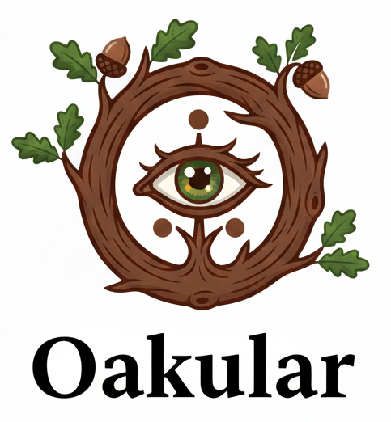
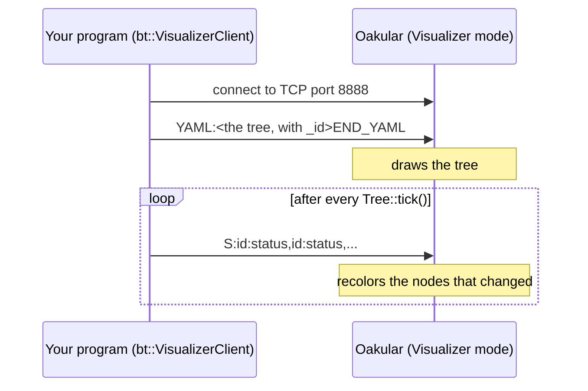

# 🔭 7. Oakular: the editor and the live visualizer

Oakular is the graphical part of BlackThorn. In this page you learn its two modes, how a running program sends its tree to it, the network protocol, and how to put the editor inside your own application.

The full API of the editor class (`oakular::Editor`), its keyboard shortcuts and its subtree tools are in [src/Oakular/README.md](../src/Oakular/README.md).

---

## 🪟 1. Two modes

| Mode | What it does |
|------|--------------|
| ✏️ **Creation** | Draw a tree with the mouse, edit its nodes, ports and blackboard, load and save the YAML file of [chapter 3](03-YAML-Format.md). |
| 👁️ **Visualizer** | Show, in real time, a tree that runs in **another program**. Each node takes the color of its status. |

Start it with `./build/linux-gcc-release/bin/Oakular`, and switch with the **Mode** menu.

---

## 🎨 2. Creation mode in short

- **File → New** (`Ctrl+N`) opens an empty document; **File → Open** loads a YAML file.
- Right click on the canvas opens the node palette; drag from the pin of a parent to a child to link them.
- Double click a node to edit its name, ports and attributes.
- The order of the children follows their position on the canvas, left to right: moving a node changes the order of execution.
- **Save** writes the same YAML as the builder reads, with `_id` on every node.

Your own action and condition names appear in the palette when the host declares them with `editor.registerNodeType("MoveToTarget", "Robot")`.

---

## 📡 3. Visualizer mode: watch your program



In your program, create a client, connect it, and give it to the tree. Then every `tick()` sends the changes by itself. From `doc/examples/Patrol`:

```cpp
#if defined(BLACKTHORN_HAS_NETWORK)
    auto visualizer = std::make_shared<VisualizerClient>();
    if (visualizer->connect("localhost", 8888))
    {
        tree->setVisualizerClient(visualizer);
    }
#endif
```

- Start Oakular in Visualizer mode **before** your program: `connect` returns `false` when nobody listens, and the tree runs without view.
- `BLACKTHORN_HAS_NETWORK` is defined when the library is built with the network (the default, [§6](#-6-build-switches)).

| Color | Status |
|-------|--------|
| 🟢 green | `SUCCESS` |
| 🟡 yellow / orange | `RUNNING` |
| 🔴 red | `FAILURE` |
| ⚪ gray | `INVALID` (not ticked yet) |

---

## 🔌 4. The protocol

Text messages over TCP, port **8888** by default. Change it on both sides: `VisualizerClient::connect(host, port)` in your program, and `./build/linux-gcc-release/bin/Oakular --port N` (or `oakular::Server(port)` in your own host).

**The tree**, sent once after the connection:

```text
YAML:<the YAML of the tree, with an _id on every node>
END_YAML
```

**The statuses**, sent after each tick, only for the nodes that changed:

```text
S:2:1,5:2,7:3
```

`id:status` pairs, where `id` is the `_id` of the node and `status` is `0` INVALID, `1` RUNNING, `2` SUCCESS, `3` FAILURE. The example above reads: node 2 runs, node 5 succeeded, node 7 failed.

Why ids and not the order of the nodes? Ids are written in the file, so they stay the same after a save and a load, and the client and the server do not need to walk the tree in the same order.

| Side | Files |
|------|-------|
| client | `src/BlackThorn/Network/VisualizerClient.hpp/.cpp`, `Tree::setVisualizerClient` |
| server | `src/Oakular/Server.hpp/.cpp` (TCP, parsing), `Editor` (polls it in `update()`), `TreeRenderer` (colors) |

---

## 🧩 5. Embed Oakular in your application

Both layers are embeddable. The engine (`bt::`) has no graphical dependency. The editor (`oakular::Editor`) is a plain Dear ImGui component: it never creates a window, an OpenGL context or an ImGui context, and never calls GLFW. A host that already has its window and its ImGui context writes:

```cpp
#include "Oakular/Oakular.hpp"

oakular::Editor m_editor;               // no width, no height, no window

// Show your own nodes in the palette
m_editor.registerNodeType("MoveToTarget", "Robot");

// Once per frame, outside of the ImGui draw calls
void MyApp::onUpdate(float dt) { m_editor.update(dt); }

// Inside your menu bar, between BeginMenuBar and EndMenuBar
void MyApp::onDrawMenuBar() { m_editor.drawMenuBar(); }

// Inside your frame, between ImGui::NewFrame() and ImGui::Render()
void MyApp::onDrawMainPanel() { m_editor.draw("Behavior Tree Editor"); }
```

What the editor cannot do alone, it asks through **signals** your host connects to: `onFileDialogRequested` (open your file browser, then call `loadFromYaml` or `saveToYaml`) and `onQuitRequested`. For the visualizer, the host gives a server: `editor.attachServer(std::make_shared<oakular::Server>())`.

`doc/examples/Embedded/Embedded.cpp` is a complete host. RobotIK embeds Oakular in its simulator the same way.

### What the host must provide

- **Dear ImGui**, compiled exactly once in the final binary (`imgui.cpp`, `imgui_draw.cpp`, `imgui_tables.cpp`, `imgui_widgets.cpp`, `misc/cpp/imgui_stdlib.cpp`, and your backends): the target `imgui` of [external/external.mk](../external/external.mk), or yours.
- **A file browser**, if you want load and save.
- **A window and an ImGui context**, created before the first `draw()`.

### Use BlackThorn in your project

A project built by [MyMakefile](https://github.com/Lecrapouille/MyMakefile) 3 reads [BlackThorn.mk](../BlackThorn.mk), which declares the two libraries, `blackthorn` (with rapidyaml in it) and `oakular`, and their third parties:

```make
TARGETS += BlackThorn myapp
BlackThorn.GIT := https://github.com/Lecrapouille/BlackThorn.git
BlackThorn.MAKEFILES := BlackThorn.mk external/external.mk
myapp.DEPENDS := oakular          # or blackthorn alone, without the editor
```

MyMakefile fetches BlackThorn, then rapidyaml and Dear ImGui at the commits of its `external/versions.lock`, and compiles the libraries with the flags of your project. `oakular` uses the headers of Dear ImGui only: your program links the target `imgui`, yours if your project declares one, so ImGui is compiled once. `BLACKTHORN_WITH_NETWORK` and `OAKULAR_WITH_SERVER` (§6) are read there too.

`doc/examples/Embedded` links `oakular` the same way, from inside this repository.

---

## 🔧 6. Build switches

Both are on by default. They are the only reason SFML network is needed:

| Switch | Effect when set to `0` |
|--------|------------------------|
| `BLACKTHORN_WITH_NETWORK` | removes `bt::VisualizerClient`: a tree can no longer send its state |
| `OAKULAR_WITH_SERVER` | removes `oakular::Server`: the Creation mode works, the Visualizer mode says it is not available |

```bash
make BLACKTHORN_WITH_NETWORK=0 OAKULAR_WITH_SERVER=0 -j8   # no SFML at all
```

Next: [08-API-Reference.md](08-API-Reference.md).
